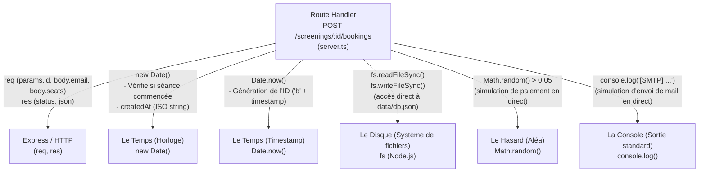

# Audit

## Routes

### GET /screenings ligne 23

json retourné : un tableau des scéance à venir

retour json success

```json
[
  {
    "id": "s1",
    "movie": "Dune: Part Three",
    "room": "Salle 1",
    "startsAt": "2026-11-06T17:02:38.990Z",
    "price": 1150,
    "remaining": 120
  }
]
```

### POST /screenings/:id/bookings ligne 49

Réserve une place. Besoin d'un format de mail valide,
que la séance ait des places restantes, et qu'elle n'ait pas commencé.
Envoie également le mail de confirmation.

payload attendu

```json
{
  "email": "matthias@ynov.com",
  "seats": 5,
  "tarif": "STUDENT"
}
```

retour json success

```json
{
  "id": "b1792400865419",
  "screeningId": "s1",
  "email": "matthias@ynov.com",
  "seats": 5,
  "tariff": "NORMAL",
  "total": 5175,
  "status": "CONFIRMED",
  "createdAt": "2026-10-19T09:07:45.419Z"
}
```

### DELETE /bookings/:id

Permet d'annuler une réservation
tant que l'annulation se fait plus de 2 heures avant la séance.
Vérifie que la réservation existe et n'est pas déja annulée.

retour json success

```json
{
  "id": "b1792400865419",
  "screeningId": "s1",
  "email": "matthias@ynov.com",
  "seats": 5,
  "tariff": "NORMAL",
  "total": 5175,
  "status": "CANCELLED",
  "createdAt": "2026-10-19T09:07:45.419Z",
  "cancelledAt": "2026-10-19T09:10:13.913Z"
}
```

### GET /bookings?email=

Récupère le tableau des reservations d'un utilisateur via son mail en params.
Affiche toutes les réservation annulées ou actives.

retour json success

/bookings?email=<matthias@ynov.com>

```json
[
  {
    "id": "b1792400865419",
    "screeningId": "s1",
    "email": "matthias@ynov.com",
    "seats": 5,
    "tariff": "NORMAL",
    "total": 5175,
    "status": "CANCELLED",
    "createdAt": "2026-10-19T09:07:45.419Z",
    "cancelledAt": "2026-10-19T09:10:13.913Z",
    "movie": "Dune: Part Three",
    "startsAt": "2026-11-06T17:02:38.990Z"
  }
]
```

### Résumé

| ligne     | bloc code                | responsabilité                                                                                                                                                                                                                                                     |
| --------- | ------------------------ | ------------------------------------------------------------------------------------------------------------------------------------------------------------------------------------------------------------------------------------------------------------------ |
| 23 - 43   | GET /screenings              | lecture de la bdd, recup des séances et calcule les places restantes                                                                                                                                                                                                   |
| 49 - 109  | POST /screenings/:id/bookings | Crée un reservastion pour une scéance vérifie les donné personnele de la reservation le nombre de place disponible ainsi que le nombre de place maximun par reservation, si la séance à déja commencer pas de resercvation également calcule du prix total à payer |
| 114 - 137 | DELETE /bookings/:id            | Annule une reservation Vérifie si l'id est valide si déja annuler et si plus de 2 heures avant le début de la scéance                                                                                                                                              |
| 142 - 155 | GET /bookings?email=...                | récupère toute les reservation assosier à l'email donnée return le film si renseigné sinon "?" et la date de début si renségé sinon "null"                                                                                                                         |

## Code Smells

| Nom                        | ligne             | probème                                                                                                                                                                                                                                             |
| -------------------------- | ----------------- | --------------------------------------------------------------------------------------------------------------------------------------------------------------------------------------------------------------------------------------------------- |
| All in one                 | fichier server.ts | tous dans un seul fichier dur à maintenir accumulation de dette technique                                                                                                                                                                           |
| calculer des place retante | 30 -32 , 72 - 74  | duplication de code function dans un service pour calculer les place restante recommandé                                                                                                                                                            |
| Lecture ecriture DB        | 12 - 18           | les function d'écriture et de lecture ne son pas dans un service à part recommander pour appeler ensuite dans chaque fichier et ne pas dupliquer le code                                                                                            |
| Id reservation             | 90                | enregistre l'id avec "b" et un timestamps si 2 personne clique sur réservation ene meme temps sur la meme scéance un problème peut survennir plus tard si annulation risque d'annulation de la mauvaise résa commbiné mail + timestamps plus sécure |
| retour sans code http      | 42                | pas de code response 200 dans la d'un GET                                                                                                                                                                                                           |
| Enum manquant              | 94, 96, 129       | les valeur son des string si une erreur de frappe impossible de faire des requete éfficacement utilisatation d'ENUM recommander                                                                                                                     |

## SOLID

| Lettre | Violation | Expliquation |
| ------ | --------- | ------------ |
| S | Oui | Toutes les fonctions sont dans un seul fichier et ont plusieurs responsabilités |
| O | Oui | L'ajout ou la modification des traitements nécessite de modifier les routes et fonctions existantes |
| L | Non applicable | Aucun héritage, car pas de poo |
| I | Non applicable | Aucune interface, car pas de poo |
| D | Oui | Les traitements accèdent directement à la db au lieu de dépendre d'une abstraction |

## Dépendances (POST /screenings/:id/bookings)

### Graphe des dépendances

Toutes les dépendances sont appelées directement au sein de la route `POST /screenings/:id/bookings` de `server.ts` :



### Remplacement dans un test sans modifier le code

Aucune dépendance ne peut être remplacée sans modifier le code : il n'y a aucune injection de dépendance, tout est codé en dur dans `server.ts` (violation du principe D de SOLID).

| Dépendance | Remplaçable sans modifier le code | Problème dans le code |
| ---------- | --------------------------------- | --------------------- |
| Temps (`new Date()`, `Date.now()`) | Non | Appel direct à `new Date()` et `Date.now()` dans la route |
| Hasard (`Math.random()`) | Non | Appel direct à `Math.random()` dans la route pour le paiement |
| Console (`console.log`) | Non | Appel direct à `console.log()` dans la route pour l'email |
| Disque (`fs` / `db.json`) | Non | Lecture et écriture directes du fichier avec `fs` |
| Express (`req`, `res`) | Non | Logique métier directement liée aux objets `req` et `res` |
