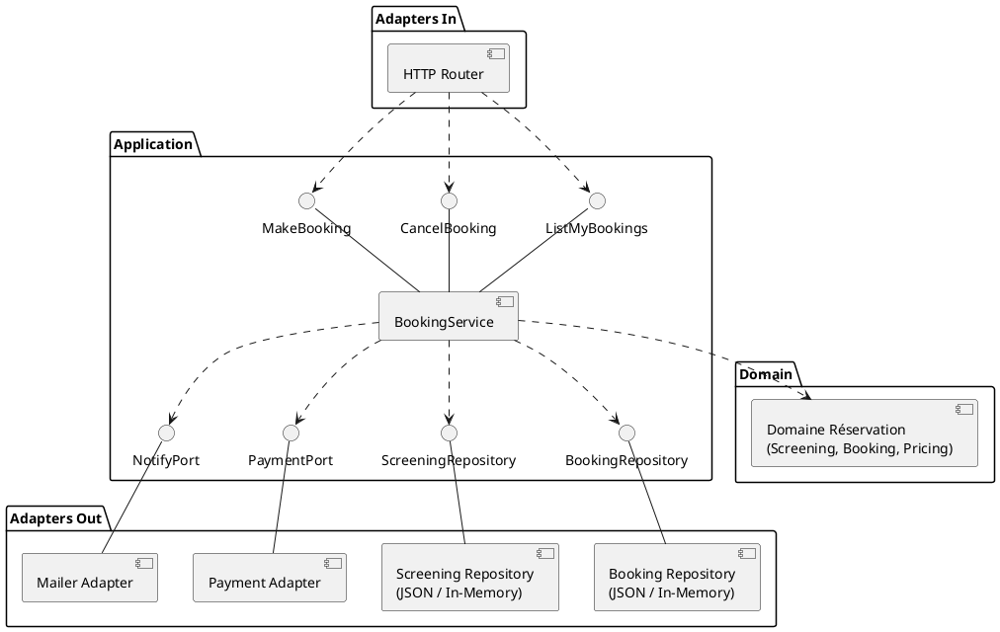
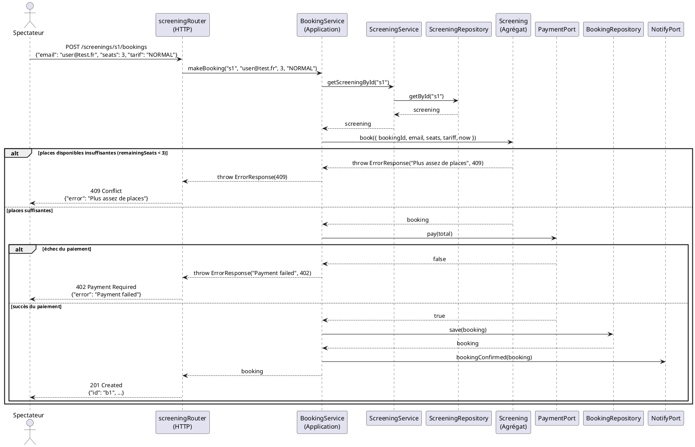

# Document d'architecture technique — CinéResa

> Binôme : Matthias DUMAS, Quentin LUCIEN-REINETTE
>
> Version : 1.0 · Date : 09/11/2026

---

## 1. Contexte et objectifs

CinéResa expose une API HTTP pour réserver et annuler des places de cinéma.

* **Utilisateurs** : Spectateurs.
* **Périmètre** : Consultation des séances, réservation et annulation de places, calcul du tarif, encaissement simulé et envoi du courriel de confirmation.
* **Hors périmètre** : Programmation des séances, gestion du catalogue de films, paiement bancaire réel et placement numéroté en salle.

## 2. Contraintes et exigences

| Élément | Scénario : intégrité des réservations sous forte charge |
| --- | --- |
| Source | 150 spectateurs simultanés |
| Stimulus | Réservent des places pour la même séance |
| Environnement | Production, ouverture des ventes |
| Artefact | [`BookingService`](../src/application/usecases/BookingService.ts) |
| Réponse | Le système valide les réservations dans la limite des places libres, rejette les demandes excédentaires et libère les places si le paiement échoue |
| Mesure | Zéro surréservation constatée, 100 % des requêtes traitées en moins de 500 ms |

## 3. Glossaire

| Terme du métier | Définition | Nom dans le code |
| --- | --- | --- |
| Séance | Projection d'un film dans une salle à un horaire précis avec une capacité et un prix unitaire. | [`Screening`](../src/domain/booking/Screening.ts) |
| Réservation | Achat de places par un spectateur pour une séance donnée. | [`Booking`](../src/domain/booking/Booking.ts) |
| Nombre de places | Quantité de sièges réservés par commande, comprise entre 1 et 6. | [`SeatCounts`](../src/domain/booking/SeatCount.ts) |
| Tarif spectateur | Catégorie tarifaire (`NORMAL` ou `STUDENT` avec 30 % de réduction). | [`UserStatus`](../src/domain/enum/UserStatuts.ts) |
| Politique tarifaire | Règles de calcul du prix total appliquant les remises étudiant et groupe (10 % dès 4 places). | [`PricingPolicy`](../src/domain/booking/PricingPolicy.ts) |
| Montant monétaire | Valeur financière immuable stockée en centimes d'euro. | [`Money`](../src/domain/shared/Money.ts) |
| Statut de réservation | État du cycle de vie d'une réservation (`CONFIRMED` ou `CANCELLED`). | [`BookingStatus`](../src/domain/enum/BookingStatus.ts) |
| Confirmation de réservation | Événement émis après le paiement réussi d'une réservation. | [`BookingConfirmed`](../src/domain/booking/events.ts) |
| Annulation de réservation | Événement émis lors de l'annulation d'une réservation (permise au moins 2 heures avant la séance). | [`BookingCancelled`](../src/domain/booking/events.ts) |
| Courriel | Adresse électronique validée du spectateur servant aux notifications. | [`Email`](../src/domain/shared/Email.ts) |

## 4. Vue logique

### 4.1 Style d'architecture

Architecture hexagonale (ports et adaptateurs) avec DDD tactique. Le domaine ([`Screening`](../src/domain/booking/Screening.ts), [`Booking`](../src/domain/booking/Booking.ts), objets-valeurs) encapsule les règles métier et ne dépend d'aucun module externe. L'application ([`BookingService`](../src/application/usecases/BookingService.ts)) orchestre les cas d'usage via des ports primaires et secondaires. Les adaptateurs d'infrastructure (HTTP, JSON, messagerie, paiement) dépendent de ces ports sans couplage direct avec le domaine.

### 4.2 Diagramme de composants UML

## 5. Vue dynamique : un cas d'erreur

Le diagramme illustre le rejet d'une commande quand la capacité restante est insuffisante, ainsi que le rejet sur incident bancaire.

## 6. Décision d'architecture

| ADR | Titre | Statut |
| --- | --- | --- |
| [001](adr/001-booking-dans-screening.md) | Booking dans l'agrégat Screening ou agrégat séparé ? | Accepté |
